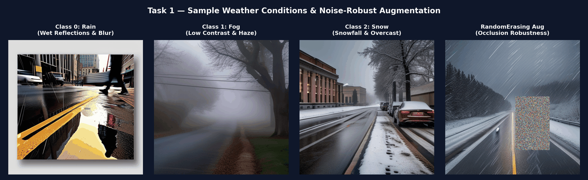
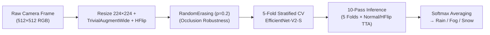
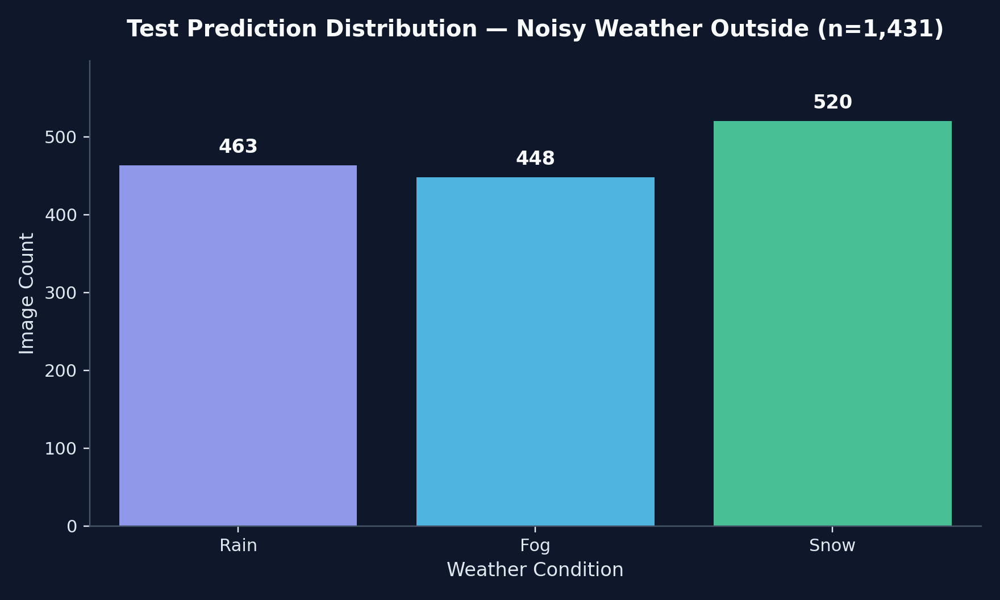
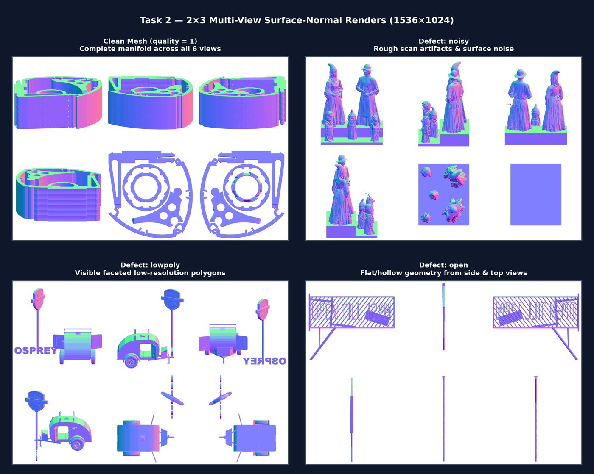
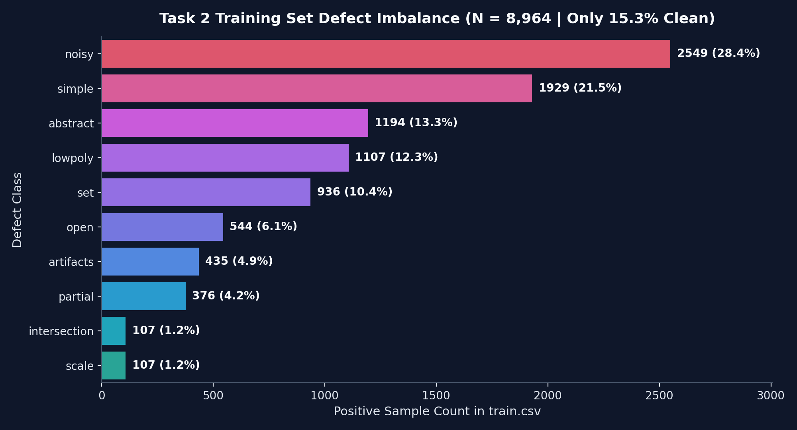
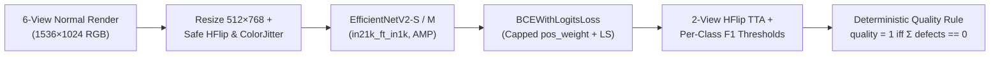

# SBER International AI Challenge for Youth (2026)

[](https://pytorch.org/)
[](https://huggingface.co/docs/timm/)
[-10B981)](#1-qualification-stage--noisy-weather-outside)
[-6366F1)](#2-main-stage--3d-mesh-quality-control)

Technical engineering writeup and reproducible computer vision pipelines for the **SBER International AI Challenge for Youth (2026)** — *AI Alliance Russia × SBER*, competing in the **University Students (Individual Participation)** track.

---

## Competition Background

The **International Artificial Intelligence Contest for Children and Youth (AI Challenge)**, organized by **SBER** and **AI Alliance Russia**, brings together international university students (under age 25) to solve real-world industrial machine learning tasks across sequential elimination rounds:

1. **Qualification Stage (June – September 2026):** Individual computer vision benchmark designed around autonomous driving perception under adverse weather distortions (*"Noisy Weather Outside"*).
2. **Main Stage (July – September 2026):** Industrial research challenge posed by **SBER AI** focused on automating quality control for large-scale 3D generative model training datasets (*"3D Mesh Quality Control: Automating Defect Detection for Training Generative Models"*).

| Stage | Challenge | Domain & Problem | Dataset Scale | Final Rank | Key Metric |
| :--- | :--- | :--- | :--- | :--- | :--- |
| **Qualification** | [Noisy Weather Outside](./task1-noisy-weather/) | Robust 3-class weather classification from noisy onboard camera frames | 2,087 train / 1,431 test (`512×512` RGB) | **5th Place** | **0.9477 Macro F1** *(0.937 / 0.876 pts recorded in dashboard)* |
| **Main Stage** | [3D Mesh Quality Control](./task2-3d-mesh-qc/) | Multi-label geometric defect detection (10 defects + usability `quality`) | 8,964 train / 669 test (`1536×1024` 6-view renders + `.npz`) | **12th Place** | **13.711 / 20.0** (`10×F1_quality + 10×WeightedF1_defects`) |

---

## 1. Qualification Stage — *Noisy Weather Outside*

### Problem & Motivation
In autonomous driving platforms, real-time weather recognition directly informs vehicle control algorithms, braking distance estimation, and sensor fusion weighting. However, onboard automotive cameras operate in degraded visual conditions: rain droplets on the lens, motion blur, washed-out contrast in heavy fog, and glare/streaks during snowfall. A production weather classifier cannot rely on clean daylight textures—it must generalize reliably when large regions of the frame are occluded or corrupted.

### Dataset Overview
- **Classes (3):** `0: rain` (`698` samples, 33.4%), `1: fog` (`637` samples, 30.5%), `2: snow` (`752` samples, 36.0%).
- **Challenge:** Unlike imbalanced classification problems, the classes are nearly balanced (~1.18:1 ratio). The primary bottleneck is **domain noise & visual artifacts** (water streaks, synthetic frame borders, blur, and fog-induced low contrast).



### Engineering Approach
- **Baseline → Final Upgrade:** Started from a `ResNet-18` baseline (`best_model.pth`) and upgraded to **`EfficientNet-V2-S`** (`torchvision.models.efficientnet_v2_s`, ImageNet-pretrained) for stronger multi-scale texture representation at low parameter overhead.
- **Noise-Resilient Augmentation:** Paired `TrivialAugmentWide()` and `RandomHorizontalFlip()` with **`RandomErasing(p=0.2, scale=(0.02, 0.2))`** to randomly corrupt image patches during training—forcing the backbone to extract distributed weather cues (road reflections, sky haze, snow accumulation) rather than overfitting to a single local patch.
- **Validation & 10-Pass Ensembling:** Trained with **5-Fold `StratifiedKFold`** (`AdamW`, `lr=2e-4`, `CosineAnnealingLR`, 15 epochs/fold, checkpointing best Macro F1 per fold). At inference, softmax probabilities are averaged across **all 5 folds × 2 TTA views** (original + horizontal flip) before taking `argmax`.



### Results
- Achieved **0.9477 Macro F1** and finished **5th Place** in the Qualification Stage (surpassing the competition's `≥ 0.90` *"Excellent solution"* threshold; dashboard recorded `0.937` Macro F1 / `0.876` scaled competition points on the `max(0, F1 - 0.50) / 0.50` scale).
- Test prediction distribution (`n=1,431`): `463` Rain, `448` Fog, `520` Snow.



→ Detailed breakdown & CLI usage: [task1-noisy-weather/README.md](./task1-noisy-weather/README.md)

---

## 2. Main Stage — *3D Mesh Quality Control*

### Problem & Motivation
Training modern 3D generative models and neural autoencoders (such as SBER AI's 3D foundation pipelines) requires massive, clean mesh datasets scraped or synthesized at scale. Raw online 3D repositories frequently contain broken topology, noisy 3D scans, flat/hollow geometry, or overly primitive shapes (`cube`, `sphere`, extruded logos). Feeding defective meshes into large 3D pretraining causes **oversimplification, poor surface smoothness, and degraded generalization**—making automated, high-throughput mesh quality filtering essential before training.

### Data Representation & Defect Taxonomy
Each 3D asset (`item_id`) comes with both raw geometry (`{item_id}.npz` containing `vertices` `(N, 3)` and `faces` `(M, 3)`) and a **`1536×1024` RGB 2×3 stitched surface-normal render** (`{item_id}.png`: 4 azimuth angles at 90° increments + top & bottom views).

The task requires predicting **11 binary targets**:
- **10 Multi-Label Defects:**
  - `noisy` (28.4%) — rough/noisy scan points or jagged polygons
  - `simple` (21.5%) — overly simple primitives (cubes, spheres, flat extruded shapes)
  - `abstract` (13.3%) — 3D text, charts, graphs, printing supports, Minecraft-style scenes
  - `lowpoly` (12.3%) — visible polygon faceting where smooth surfaces are expected
  - `set` (10.4%) — disconnected/unrelated objects scattered in one scene
  - `open` (6.1%) — hollow interiors or flat planes lacking 3D volume
  - `artifacts` (4.9%) — broken triangle transitions, surface glitches
  - `partial` (4.2%) — object occluded on one side by walls/planes
  - `intersection` (1.2%) — meshes intersecting or penetrating each other
  - `scale` (1.2%) — object too small in frame or poorly scaled
- **Overall Suitability (`quality`):** Only **15.3%** (`1,372 / 8,964`) of training meshes are defect-free (`quality = 1`).





### Key Engineering Decisions & Iterative Story (V1 → V11)

1. **Why 2D Surface-Normal Multi-View CNN over Raw `.npz` Point Clouds:**
   Normal-shaded 6-view renders already expose geometric cues visually—faceted flat shading reveals `lowpoly`, missing silhouettes in top/side panes reveal `open`, noisy normal gradients reveal `noisy`, and semantic cues reveal `abstract` (e.g., 3D text/logos) far better than raw subsampled point clouds, while allowing ImageNet-21k pretrained vision backbones (`timm`) to transfer strong edge/surface priors.
2. **Surviving Extreme Imbalance & Gradient Explosions (V2 → V5):**
   Uncapped `pos_weight = neg/pos` reached `~82.8×` on rare classes (`scale`, `intersection`), destabilizing gradients. Capping `pos_weight` at `[1.0, 25.0]`, adding `clip_grad_norm_(1.0)`, and moving to high-resolution **`512×768`** with **`tf_efficientnetv2_s.in21k_ft_in1k`** jumped the score from `12.12` (V2) to **`13.711 / 20.0`** (V5).
3. **What Failed & Why (Engineering Post-Mortems):**
   - *MVCNN View Cropping (V3):* Splitting the `1536×1024` sheet into 6 independent `256×256` crops + cross-view max-pooling lost global cross-view context (critical for `set`, `partial`, and `open`) and trained unstably.
   - *Aggressive Geometric Augmentations (V6):* Adding `RandomVerticalFlip` and `RandomRotation(15°)` broke canonical 3D up/down camera view priors in the 2×3 grid, hurting generalization—reverting to orientation-safe horizontal flips and mild `ColorJitter` in V7/V8 stabilized training (`12.712`).
4. **Fixing "The Fatal Flaw" — Deterministic Quality Rule:**
   The competition metric equally weights global suitability and weighted defect F1:
   $$\text{Score} = 10 \times \text{F1}(\text{quality}) + 10 \times \text{F1}_{\text{weighted}}(\text{10 defects})$$
   Early models predicted `quality` independently from the 10 defect logits, frequently producing contradictory outputs (e.g., predicting `noisy=1` AND `quality=1`). Verifying `train.csv` showed **0 mismatches** across all `8,964` samples: `quality == 1` holds **if and only if** all 10 defects are `0`. Enforcing this rule deterministically after per-class F1 threshold optimization (`0.10–0.85`) and 2-view horizontal-flip TTA eliminated head contradictions and unlocked major score gains.
5. **Scaling Capacity Under Memory Constraints (V9 → V11):**
   Upgraded to **`tf_efficientnetv2_m.in21k_ft_in1k`** (`drop_rate=0.3`) at `512×768` using **AMP (`torch.amp.autocast` + `GradScaler`)**, `batch_size=4` with `gradient_accumulation_steps=2` (effective batch 8), "Goldilocks" `pos_weight` cap `[1.0, 5.0]` (preventing rare-class over-prediction from hurting `weighted` F1), and **5% label smoothing**.



### Results
- Progressed from **12.12** (V2) → **12.712** (V8) → **13.711 / 20.0** (V5 final submission), finishing **12th Place** in the Main Stage.


→ Full V1–V11 experiment table & CLI usage: [task2-3d-mesh-qc/README.md](./task2-3d-mesh-qc/README.md)

---

## Repository Layout & Quickstart

```text
sber-ai-challenge-2026/
├── README.md
├── .gitignore
├── docs/images/                          # Visual samples, imbalance charts & prediction distributions
├── submissions/                          # Final competition submission CSVs
├── task1-noisy-weather/
│   ├── train_and_infer.py                # Standalone 5-fold Stratified CV + 10-pass TTA script
│   └── visualize_results.py              # Test prediction distribution plotter
└── task2-3d-mesh-qc/
    ├── eda.py                            # Dataset integrity, imbalance & invariant verification
    ├── train_and_infer.py                # Unified V5 / V11 training & inference pipeline
    ├── visualize_results.py              # Defect detection frequency plotter
    └── notebooks/                        # Portable Colab-free reference notebooks (V1, V5, V11)
```

See each task's README for exact installation and CLI reproduction steps:
- [Task 1: Noisy Weather Outside](./task1-noisy-weather/README.md)
- [Task 2: 3D Mesh Quality Control](./task2-3d-mesh-qc/README.md)
