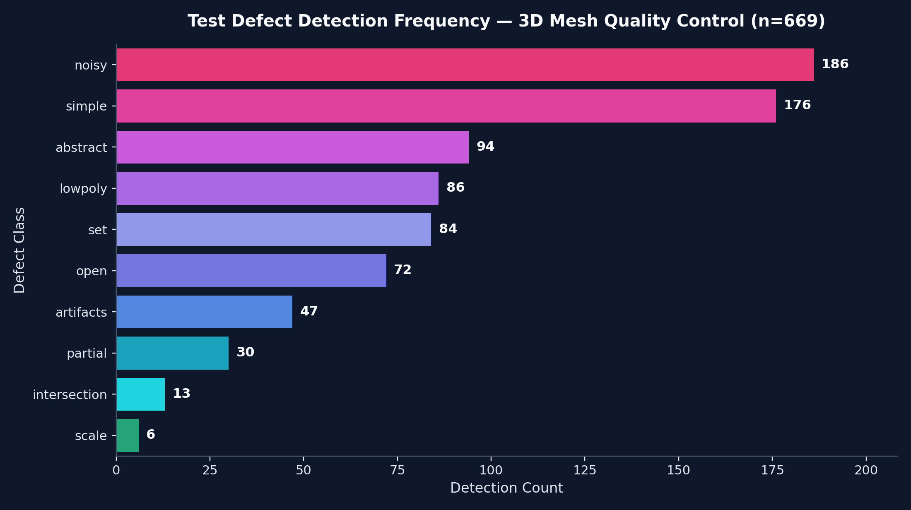

# SBER International AI Challenge for Youth (2026)

[](https://pytorch.org/)
[](https://huggingface.co/docs/timm/)
[-10B981)](#1-qualification--noisy-weather-outside)
[-6366F1)](#2-main-stage--3d-mesh-quality-control)

End-to-end computer vision solutions developed for the **SBER International AI Challenge for Youth (2026, University Students Individual Track)** across both the Qualification and Main stages.

---

## Competition Summary

| Stage | Task | Data & Format | Core Approach | Validation | Best Result | Rank |
| :--- | :--- | :--- | :--- | :--- | :--- | :--- |
| **Qualification** | [Noisy Weather Outside](./task1-noisy-weather/) | 2,087 train / 1,431 test RGB images (`512×512`), 3 classes | 5-Fold `EfficientNet-V2-S` + `TrivialAugmentWide` + `RandomErasing` + 10-pass TTA | 5-Fold Stratified CV | **0.9477 Macro F1** *(0.937 / 0.876 pts recorded in dashboard)* | **5th** |
| **Main Stage** | [3D Mesh Quality Control](./task2-3d-mesh-qc/) | 8,964 train / 669 test assets (`1536×1024` 6-view renders + `.npz` geometry), 11 binary targets | Multi-view 2D `tf_efficientnetv2_s/m` (`512×768`) + `pos_weight` + per-class F1 thresholds + Deterministic Quality Rule | 80/20 Holdout + H-Flip TTA | **13.711 / 20.0** (`10×F1_quality + 10×WeightedF1_defects`) | **12th** |

---

## Repository Structure

```text
sber-ai-challenge-2026/
├── README.md
├── .gitignore
├── docs/
│   └── images/
│       ├── weather_distribution.png
│       └── mesh_defect_distribution.png
├── submissions/
│   ├── noisy_weather_submission.csv
│   └── 3d_mesh_qc_submission.csv
├── task1-noisy-weather/
│   ├── README.md
│   ├── requirements.txt
│   ├── train_and_infer.py
│   └── visualize_results.py
└── task2-3d-mesh-qc/
    ├── README.md
    ├── requirements.txt
    ├── eda.py
    ├── train_and_infer.py
    ├── visualize_results.py
    └── notebooks/
        ├── 01_baseline_efficientnet_b0.ipynb
        ├── 02_v5_efficientnetv2_s_final.ipynb
        └── 03_v11_efficientnetv2_m_amp.ipynb
```

---

## 1. Qualification — *Noisy Weather Outside*

Classify weather conditions (`0: rain`, `1: fog`, `2: snow`) from distorted onboard autonomous-driving camera frames containing blur, lens droplets, low contrast, and environmental noise.

### Key Highlights
- **Backbone:** Upgraded from a `ResNet-18` baseline to `EfficientNet-V2-S` (`torchvision`).
- **Noise-Robust Augmentation:** Combined `TrivialAugmentWide()`, horizontal flipping, and `RandomErasing(p=0.2)` on `224×224` normalized RGB inputs.
- **Validation & Ensembling:** 5-Fold `StratifiedKFold` (`AdamW`, `CosineAnnealingLR`, 15 epochs/fold) with 10-pass test inference averaging softmax probabilities across **5 folds × 2 views** (original + horizontal flip TTA).


→ Full details & CLI instructions: [task1-noisy-weather/README.md](./task1-noisy-weather/README.md)

---

## 2. Main Stage — *3D Mesh Quality Control*

Automated multi-label defect detection across 10 defect categories (`noisy`, `simple`, `abstract`, `lowpoly`, `set`, `open`, `artifacts`, `partial`, `intersection`, `scale`) and overall asset usability (`quality`) for filtering generative 3D datasets.

### Key Highlights
- **Multi-View 2D Formulation:** Trained directly on `1536×1024` stitched 6-view renders (4 azimuth views at 90° increments + top/bottom) resized to `512×768` using `tf_efficientnetv2_s.in21k_ft_in1k` (V5) and `tf_efficientnetv2_m.in21k_ft_in1k` with AMP + gradient accumulation (V11).
- **Severe Class Imbalance Handling:** Rare defects such as `scale` and `intersection` appear in only **1.2%** (`107/8,964`) of samples. Evaluated Focal Loss, Weighted Focal Loss, MVCNN view-cropping, and stabilized `BCEWithLogitsLoss` with capped `pos_weight` and 5% label smoothing.
- **Per-Class Thresholding & Deterministic Quality Rule:** Optimized per-class probability thresholds (`0.10–0.85`) on validation F1, applied 2-view horizontal flip TTA, and enforced the dataset invariant (`quality = 1` iff zero defects predicted), improving scores from **12.12** (V2) → **12.712** (V8) → **13.711 / 20.0** (V5).



→ Full experiment log & CLI instructions: [task2-3d-mesh-qc/README.md](./task2-3d-mesh-qc/README.md)
