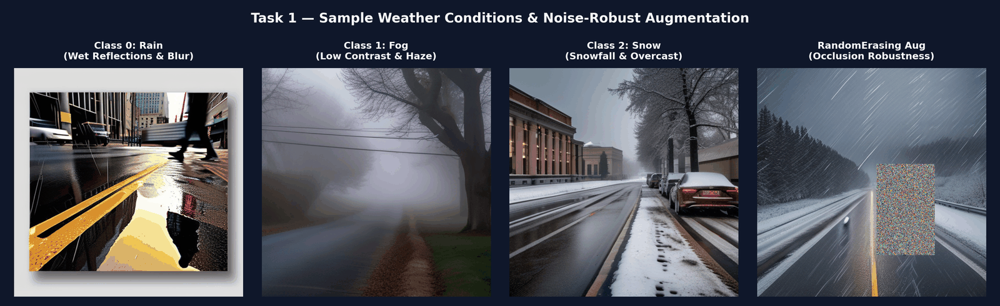
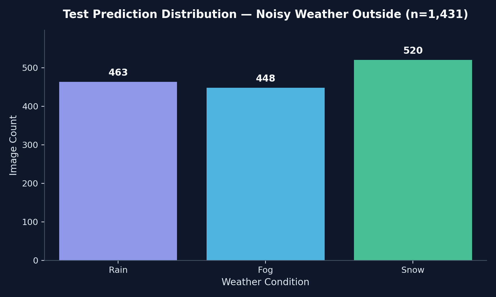

# Task 1: Noisy Weather Outside (Qualification Stage)

> **Result:** **5th Place** · **0.9477 Macro F1** *(dashboard recorded `0.937` Macro F1 / `0.876` scaled points)*

---

## 1. Problem Background & Motivation

In autonomous driving stacks, reliable perception of adverse weather conditions is safety-critical—directly affecting speed limits, braking distance estimation, lane-keeping confidence, and sensor weighting between LiDAR, radar, and RGB cameras.

Onboard vehicle cameras frequently suffer from severe environmental degradations:
- Rain streaks, specular wet-road glare, and lens droplets
- Heavy fog reducing global contrast and obscuring distant geometry
- Falling snow particles, motion blur, and overcast color desaturation

The goal of this qualification task is to classify road-scene camera frames into **3 weather classes** (`0: rain`, `1: fog`, `2: snow`) despite heavy visual noise and artifacts.

---

## 2. Dataset & Evaluation Metric

### Dataset Composition
- **Train (`train.csv`):** `2,087` labeled `512×512` RGB PNG images
  - `0` (`rain`): `698` images (`33.4%`)
  - `1` (`fog`): `637` images (`30.5%`)
  - `2` (`snow`): `752` images (`36.0%`)
- **Test (`test.csv`):** `1,431` unlabeled `512×512` RGB PNG images



### Competition Scoring Scale
Evaluation is based on **Macro F1-score** across all 3 classes, scaled onto `[0, 1]` points:

$$\text{Points} = \max\left(0, \frac{\text{Macro F1} - 0.50}{1.0 - 0.50}\right)$$

Solutions below `0.50` Macro F1 receive `0` points (disqualified from advancing); `≥ 0.75` is rated *Good* and `≥ 0.90` is rated *Excellent*.

---

## 3. Solution Architecture & Design Choices

### From Baseline to Final Pipeline
1. **Baseline (`ResNet-18`):** Trained an initial `ResNet-18` classifier (`best_model.pth`) as recommended in the task starter guidelines to establish a working end-to-end benchmark.
2. **Backbone Upgrade (`EfficientNet-V2-S`):** Replaced `ResNet-18` with `torchvision.models.efficientnet_v2_s` (`EfficientNet_V2_S_Weights.DEFAULT`), swapping `classifier[1]` for a 3-class linear head. EfficientNet-V2-S uses Fused-MBConv blocks in early stages, capturing fine high-frequency weather textures (rain streaks, snowflakes) alongside global haze cues efficiently at `224×224`.
3. **Noise-Robust Augmentation Strategy:**
   - `TrivialAugmentWide()` — parameter-free automated augmentation policy introducing diverse photometric/geometric perturbations without tuning overhead.
   - `RandomHorizontalFlip()` — doubles effective road-scene viewpoint diversity.
   - `RandomErasing(p=0.2, scale=(0.02, 0.2))` — masks random rectangular regions with noise during training, preventing over-reliance on localized sky/road patches that may be occluded by water droplets or wiper blades at test time.
4. **5-Fold Stratified Cross-Validation:**
   - `StratifiedKFold(n_splits=5, shuffle=True, random_state=42)` preserves exact `rain / fog / snow` class proportions in every fold.
   - Trained for `15 epochs` per fold with `CrossEntropyLoss`, `AdamW(lr=2e-4, weight_decay=1e-4)`, and `CosineAnnealingLR(eta_min=1e-6)`, saving the checkpoint achieving the highest validation **Macro F1** per fold.
5. **10-Pass Ensemble + Test-Time Augmentation (TTA):**
   - Each test image is evaluated across all **5 fold checkpoints × 2 views** (original + horizontal flip).
   - Softmax probabilities from all 10 forward passes are averaged equally prior to `argmax`, reducing single-model variance on borderline rain/snow and fog/snow scenes.

---

## 4. Results

- **Qualification Rank:** **5th Place**
- **Macro F1:** **0.9477** *(competition dashboard snapshot: `0.937` Macro F1 / `0.876` points)*
- **Test Prediction Distribution (`n=1,431`):** `463` Rain · `448` Fog · `520` Snow



---

## 5. Reproduction & CLI Usage

```bash
pip install -r requirements.txt

# Train 5 folds and generate outputs/submission.csv
python train_and_infer.py \
  --train-csv path/to/train.csv \
  --test-csv path/to/test.csv \
  --train-dir path/to/train \
  --test-dir path/to/test \
  --output-dir outputs \
  --epochs 15 \
  --batch-size 32

# Inference-only from saved fold checkpoints (best_model_fold_0..4.pth)
python train_and_infer.py \
  --test-csv path/to/test.csv \
  --test-dir path/to/test \
  --output-dir outputs \
  --skip-train

# Regenerate prediction distribution chart
python visualize_results.py
```
