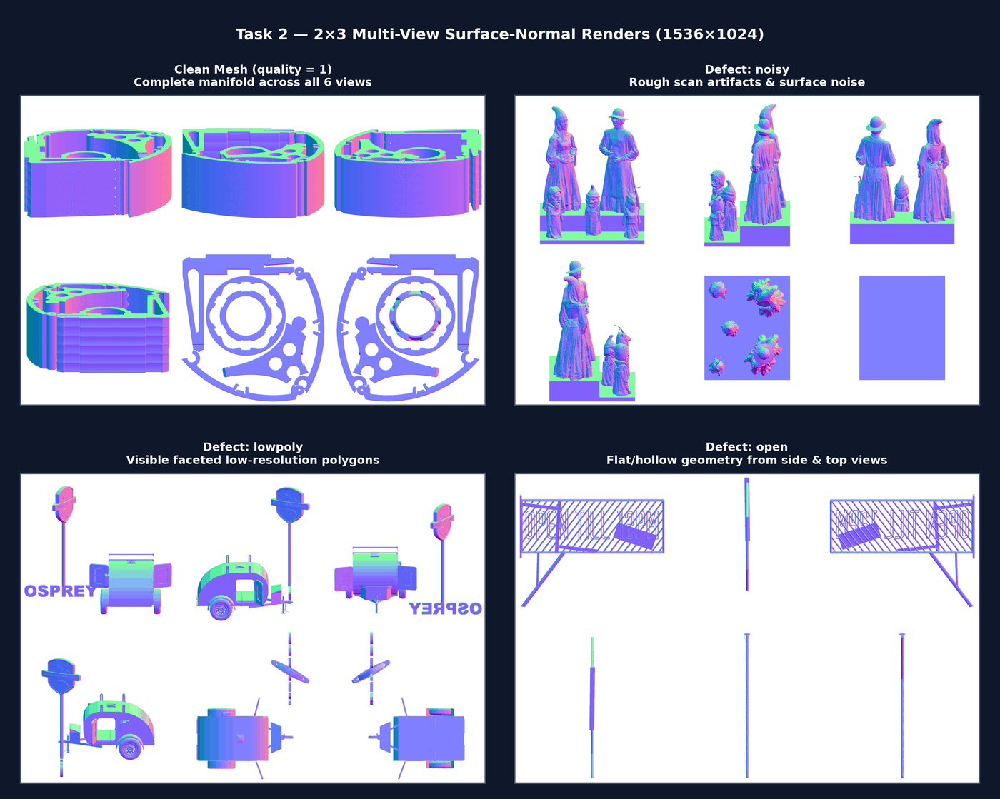
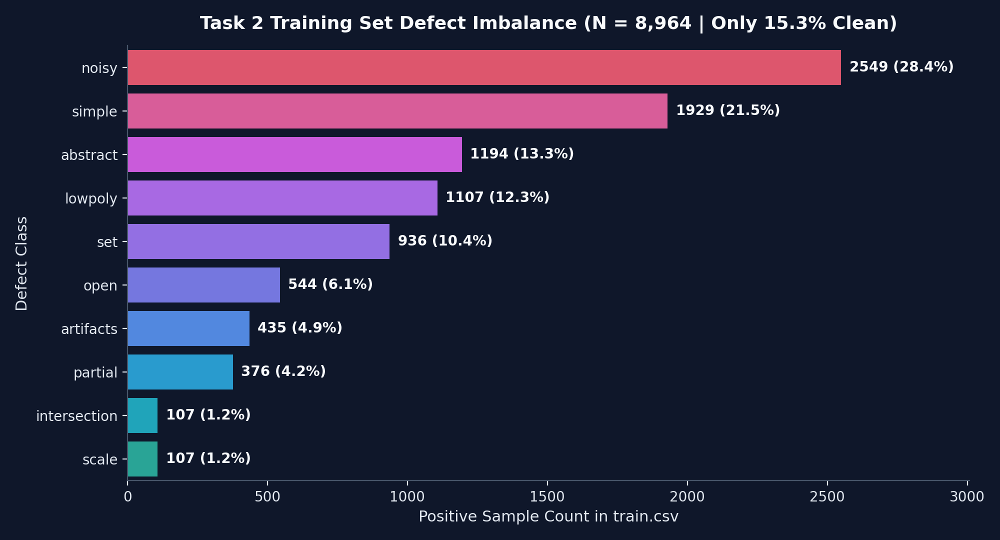
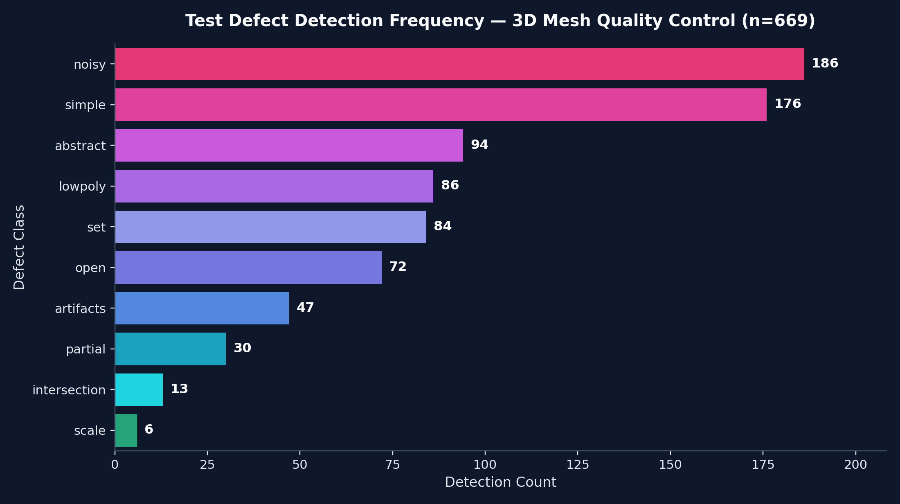

# Task 2: 3D Mesh Quality Control (Main Stage)

> **Result:** **12th Place** · **13.711 / 20.0** Competition Score (`submission_final` / V5)

---

## 1. Problem Background & Motivation

Generative 3D AI models and 3D neural autoencoders depend critically on clean, manifold, high-detail training corpora. However, large-scale 3D mesh datasets scraped from the web are heavily contaminated with geometric defects—noisy 3D scans, flat/open surfaces without volume, intersecting meshes, overly low-poly models, or trivial primitives (cubes, text, extruded logos).

Including defective assets in pretraining degrades geometric fidelity and causes generative models to oversimplify shapes. **SBER AI** posed this Main Stage challenge to automate **3D mesh defect classification and dataset usability filtering**.

---

## 2. Dataset, Taxonomy & Evaluation Metric

### Multimodal Asset Format
- **Train:** `8,964` 3D assets (`train.csv`)
- **Test:** `669` 3D assets (`test.csv`)
- Each `item_id` provides two files:
  - `{item_id}.png` — **`1536×1024` RGB 2×3 stitched surface-normal render** showing the normalized object inside a unit cube from **6 canonical viewpoints** (4 azimuth views at 90° increments + top view + bottom view).
  - `{item_id}.npz` — Raw 3D mesh arrays (`vertices` `(N, 3)` `float32`, `faces` `(M, 3)` `int32`).

### 11 Binary Targets & Defect Taxonomy
Models predict **10 multi-label defect flags** plus **1 overall usability flag (`quality`)**:

| Target | Train Positives | Share | Official Defect Definition |
| :--- | ---: | ---: | :--- |
| `noisy` | 2,549 | 28.44% | Rough, noisy vertices/polygons typical of raw 3D scans |
| `simple` | 1,929 | 21.52% | Overly simple primitives (cube, sphere, cylinder), flat objects, extruded logos |
| `abstract` | 1,194 | 13.32% | 3D text, charts, graphs, 3D printing supports, Minecraft-style non-coherent scenes |
| `lowpoly` | 1,107 | 12.35% | Insufficient polygon density; visible sharp faceting where smooth surfaces belong |
| `set` | 936 | 10.44% | Multiple unrelated objects or separated parts in one scene |
| `open` | 544 | 6.07% | Hollow interior or flat curved surfaces lacking 3D volume (empty side/top views) |
| `artifacts` | 435 | 4.85% | Strange triangle transitions, surface glitches, broken mesh appearance |
| `partial` | 376 | 4.19% | Scene occluded from certain angles (e.g., blocked by a wall or plane) |
| `intersection` | 107 | 1.19% | Scene objects strongly intersecting or penetrating each other |
| `scale` | 107 | 1.19% | Object occupies too little frame or poor scale making details indistinguishable |
| **`quality`** | **1,372** | **15.31%** | **`1` if defect-free and suitable for generative pretraining; `0` otherwise** |





### Ground-Truth Structural Invariant
Running [eda.py](./eda.py) across all `8,964` training rows confirms **0 exceptions**:

$$\text{quality} = 1 \iff \sum_{d \in \text{defects}} d = 0$$

### Competition Metric (max `20.0` points for predictions)

$$\text{Score} = 10 \times \text{F1}(\text{quality}) + 10 \times \text{F1}_{\text{weighted}}(\text{10 defects})$$

---

## 3. Engineering Journal & Experimental Progression (V1 → V11)

Because the surface-normal 2×3 renders encode rich geometric cues (flat faceting for `lowpoly`, missing silhouettes for `open`, high-frequency normal jitter for `noisy`, and semantic structures for `abstract`), we formulated the task as **high-resolution 2D multi-view classification** with `timm` vision backbones—iterating across 11 versions to diagnose and solve training bottlenecks:

| Version | Backbone | Input Size | Loss & Weighting | Key Architectural / Training Change | Recorded Score |
| :--- | :--- | :--- | :--- | :--- | :--- |
| **V1** | `efficientnet_b0` | `384×576` | `BCEWithLogitsLoss()` | Baseline predicting 10 defects only (`LR=1e-3`) | — |
| **V2** | `efficientnet_b3` | `384×576` | `BCE(pos_weight)` uncapped | Predicted all 11 targets + per-class threshold search + H-flip TTA | `12.12` |
| **V3-MVCNN** | `efficientnet_b1` | `6 × 256×256` | `BCE(pos_weight<=15)` | Cropped 6 separate views + cross-view logit max-pooling; unstable | — |
| **V3-Focal** | `efficientnet_b3` | `512×768` | `FocalLoss(gamma=2.0)` | High resolution + replaced explosive `pos_weight` with Focal Loss | — |
| **V5 (Final CSV)** | `tf_efficientnetv2_s.in21k_ft_in1k` | `512×768` | `BCE(pos_weight<=25)` | ImageNet-21k backbone + grad clip `1.0` + **Deterministic Quality Rule** | **`13.711`** |
| **V6** | `tf_efficientnetv2_s.in21k_ft_in1k` | `512×768` | `WeightedFocalLoss` | Added `VerticalFlip` + `RandomRotation(15°)` + 3-way TTA (over-perturbed 3D views) | — |
| **V7** | `convnext_tiny.in12k_ft_in1k_384` | `384×576` | `BCE(pos_weight<=25)` | Removed V-flip/rotation; kept orientation-safe H-flip & ColorJitter | — |
| **V8 (Safeguard)** | `tf_efficientnetv2_s.in21k_ft_in1k` | `384×576` | `BCE(pos_weight<=25)` | Fast anti-overfitting safeguard (`batch_size=16`, 8 epochs) | `12.712` |
| **V9–V10** | `tf_efficientnetv2_m.in21k_ft_in1k` | `512×768` | Unweighted `BCE` | Scaled to Medium backbone + added `AMP` (`autocast` + `GradScaler`) | — |
| **V11 (Latest)** | `tf_efficientnetv2_m.in21k_ft_in1k` | `512×768` | `BCE(pos_weight<=5)` + 5% LS | Goldilocks `pos_weight<=5`, Label Smoothing `0.05`, `drop_rate=0.3`, Grad Accum `2` | — |

### Four Critical Engineering Lessons

1. **Resolution Matters for Microscopic Geometry (`384×576` → `512×768`):**
   Downscaling a `1536×1024` 6-view sheet too aggressively blurs subtle triangle `artifacts`, `noisy` scan bumps, and fine `lowpoly` faceting. Raising resolution to `512×768` paired with ImageNet-21k pretrained `tf_efficientnetv2_s` (V5) and `tf_efficientnetv2_m` (V11) preserved fine surface-normal gradients.
2. **Whole-Sheet Global Context Beats Naive MVCNN Cropping:**
   Cropping the 6 views separately (V3-MVCNN) prevented the model from comparing views side-by-side—hurting global defects like `open` (where two views appear blank/flat) and `set` (spatial separation across angles). Processing the full 2×3 sheet jointly allowed self-attention/convolutional receptive fields to cross-reference views naturally.
3. **Orientation-Safe Augmentations Only:**
   In V6, applying `RandomVerticalFlip` and `RandomRotation(15°)` scrambled the canonical arrangement of top/bottom/side renders in the 2×3 grid, hurting convergence. Restricting augmentations to `RandomHorizontalFlip` and mild `ColorJitter(0.1, 0.1)` preserved 3D spatial layout semantics.
4. **"The Fatal Flaw" & Deterministic Quality Rule:**
   Because `F1(quality)` contributes **50%** (`10 / 20` points) of the total metric, any contradiction between the predicted defect flags and the `quality` head directly forfeits points. Enforcing `quality = (sum(defects) == 0).astype(int)` after per-class threshold tuning (`0.10–0.85` step `0.05`) and 2-view horizontal-flip TTA guaranteed 100% logical consistency across all `669` test predictions (`104` clean / `565` defective).

---

## 4. Results

- **Main Stage Rank:** **12th Place**
- **Best Recorded Score:** **`13.711 / 20.0`** (V5 `submission_final.csv`, up from `12.12` in V2 and `12.712` in V8)



---

## 5. Reproduction & CLI Usage

```bash
pip install -r requirements.txt

# 1. Inspect dataset shapes, class imbalance, and deterministic quality invariant
python eda.py --train-csv path/to/train.csv --train-dir path/to/train

# 2. Train & predict using V5 preset (tf_efficientnetv2_s, 512x768, pos_weight<=25)
python train_and_infer.py \
  --preset v5 \
  --train-csv path/to/train.csv \
  --test-csv path/to/test.csv \
  --train-dir path/to/train \
  --test-dir path/to/test \
  --output-dir outputs

# Or run V11 preset (tf_efficientnetv2_m, AMP + Grad Accum, pos_weight<=5, Label Smoothing 0.05)
python train_and_infer.py --preset v11 ...

# 3. Regenerate defect distribution chart
python visualize_results.py
```
